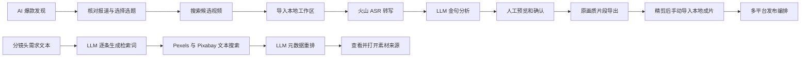

# 全链路 AI 爆款视频生产工作台

一个面向短视频内容生产的本地工作台：从发现热点、筛选视频金句，到检索 B-roll 素材、导出成片和编排多平台发布，尽量把重复操作收进同一套流程。项目提供浏览器工作台和 Electron 桌面应用，AI 与素材服务通过用户自己的供应商配置接入。

应用内部名称为 **MP4 Golden Clip Workbench / MP4 金句片段工作台**。适合从访谈、演讲、课程或发布会中筛选可传播片段，也可以单独用于寻找分镜头所需的补充画面。

**阅读导航：** [功能](#功能概览) · [使用流程](#主要工作流) · [B-roll 原理](#b-roll-检索说明) · [安装](#快速开始) · [供应商配置](#首次配置) · [数据位置](#数据与隐私) · [开发打包](#开发与打包) · [常见问题](#常见问题) · [第三方许可](#许可证与第三方组件)

## 功能概览

| 模块 | 能力 |
| --- | --- |
| AI 爆款发现 | 获取热点候选、查看来源报道、选择选题，并搜索 Bilibili 和抖音视频素材；选题偏好可保存为本地知识库 |
| 金句提取 | 上传 MP4/MOV、预览视频、选择转写范围、生成带时间戳的文字稿，并用 LLM 筛选和整理候选片段 |
| 片段复核与导出 | 预览候选片段、微调时间、人工确认后导出；最终导出复制原视频/音频流，不重新编码 |
| B-roll 素材检索 | 粘贴已有分镜头需求，为每条需求生成英文检索词，从 Pexels、Pixabay 搜索并按元数据相关性重排 |
| 一键发布 | 为抖音、视频号和小红书编排发布任务；按平台登录并填充元数据，可选择人工确认等发布方式 |
| 任务中心 | 查看转写、分析、预览、导出、热点发现和发布任务的进度与历史 |
| 存储管理 | 查看工作区和输出结果，清理预览、缓存或历史任务 |
| 供应商管理 | 分别配置 LLM、火山语音转写与 TOS、Pexels、Pixabay 服务 |

## 主要工作流



各模块可以单独使用，不要求从热点发现开始走完整条链路。

### 从长视频提取金句

1. 在“供应商管理”配置并启用火山转写服务和一个 LLM。
2. 在“金句提取”上传本地 MP4/MOV，选择需要转写的起止时间。如果浏览器无法正常显示画面，生成兼容预览。
3. 开始转写，在文字稿中阅读、复制或搜索关键词，也可以保存带时间戳的文字稿。
4. 设置目标片段数与最短、最长时长，启动金句分析。
5. 逐条核对候选片段的内容、标题、推荐理由和时间边界，生成预览并微调起止时间。
6. 确认需要保留的片段，选择目录并导出；每个已导出的片段同时附带 `analysis.md` 分析文案。

LLM 会返回标题建议、核心金句、推荐理由、封面与开场文案、话题标签等内容。后端还会按质量、内容相似度和时间重叠进行筛选，因此“目标片段数”是筛选目标，不保证每次都能得到指定数量。

最终导出采用 FFmpeg 流复制，保留工作区原视频的音视频编码；兼容预览是单独生成的 H.264/AAC 文件。流复制的切点会受源文件关键帧影响，导出边界可能与转码预览略有差异，需要复核。

### 从热点寻找源视频

1. 在“爆款搜索”选择时间范围并点击“获取热点”。
2. 核对来源报道，勾选想制作的热点，最多选择 10 条。
3. 选择 Bilibili、抖音素材来源，点击“搜索视频素材”。
4. 查看生成的选题、证据与候选素材；需要时将候选视频下载并导入金句提取工作区。

当前热点来源为 36Kr 报道，平台视频搜索通过集成的 MediaCrawler 完成，下载导入使用 yt-dlp。可把以往选题和反馈写入“选题偏好知识库”，由 AI 结构化保存，作为轻量排序参考；这不是模型训练。

### 发布已有视频

1. 在“一键发布”点击“选择本地视频”，导入准备好发布的完整视频，再从列表中选择。金句导出片段不会自动进入发布列表，通常先在其他剪辑工具中完成精剪再导入。
2. 为目标平台执行“登录准备”，在打开的 Google Chrome 窗口中完成登录。
3. 按平台分别填写标题、描述、短标题或话题标签，选择发布方式后创建任务。

| 平台 | 当前界面提供的发布方式 |
| --- | --- |
| 抖音 | 填好页面后人工确认；自动点击发布 |
| 视频号 | 人工确认；自动点击发布；保存为草稿 |
| 小红书 | 自动点击发布 |

多平台任务按顺序执行，同一时间只初始化一个发布器。人工确认模式下，任务完成填表并不代表视频已经发布，仍需在平台页面确认；实际发布结果应以平台创作者中心为准。

## B-roll 检索说明

1. 用户输入已经划分好的分镜头需求，可带编号，也可以用空行分隔。当前实现按非空行对应镜头，单次最多 20 条。
2. LLM 按原有顺序为每条需求生成 2–3 个适合素材平台的英文短语，不重新拆分或合并分镜头。
3. 工作台使用 Pexels 和 Pixabay 的 API 进行文本检索，合并重复候选。
4. LLM 根据候选的标题、描述或标签、时长、分辨率及匹配检索词重排结果，并给出简短理由。
5. 用户打开素材平台页面查看和使用素材。

例如可以输入：

```text
1. 清晨的城市街道，行人匆忙走向办公楼。

2. 工厂机械臂组装产品，需要能够看清机械运动的画面。

3. 创业者在办公室白板前向团队讲解方案。
```

使用前需要同时启用 **LLM、Pexels 和 Pixabay**。每个镜头按平台分别展示检索词、候选链接与推荐理由，每个平台最多展示 8 个候选；检索在后台执行，界面显示生成检索词、搜索和重排等阶段进度。

元数据重排不是 AI 识图：当前流程不分析素材视频画面，也不根据播放量或热度排序。平台返回的描述不完整时，LLM 判断也会受到限制，最终应打开素材查看真实画面。

GA 按钮会把第一条非空需求作为关键词带到 [GA 搜索](https://ga.nasuyun.com/) 页面；它是独立的人工搜索入口，不是工作台内置的 API 检索或 Playwright 爬取流程。B-roll 模块提供搜索结果和来源链接，不会自动下载素材。

当前没有内置 AI 配音、AI 视频生成或自动把 B-roll 拼接成完整视频的模块，脚本创作和后续精剪可在其他工具中完成。

## 技术结构

| 层 | 技术 |
| --- | --- |
| 前端 | HTML、CSS、原生 JavaScript |
| 本地服务 | Python 标准库 `http.server`，通过本机 HTTP API 提供页面和后台任务 |
| 桌面应用 | Electron，启动并管理本地 Python 后端 |
| 视频处理 | FFmpeg / FFprobe；兼容预览会按需转码，最终片段导出使用原始音视频流 |
| 热点与素材采集 | 集成 MediaCrawler 及平台发布适配器 |
| AI 与云服务 | 由用户配置的 LLM、火山引擎 ASR/TOS、Pexels、Pixabay |

## 快速开始

### 方式一：使用桌面构建产物

仓库的 GitHub Actions 提供 Windows x64 安装包和 macOS Apple Silicon（arm64）DMG 构建：

- [Windows 构建工作流](https://github.com/sjq98/Full-chain-AI-automated-generation-of-viral-videos/actions/workflows/build-windows.yml)
- [macOS arm64 DMG 构建工作流](https://github.com/sjq98/Full-chain-AI-automated-generation-of-viral-videos/actions/workflows/build-macos.yml)

打开对应的成功构建任务，在 **Artifacts** 区域下载产物。Actions 构建产物并不等同于 GitHub Release。macOS DMG 当前未配置 Developer ID 签名与 Apple notarization，首次打开时 macOS 可能显示安全提示。

下载 Actions 产物通常需要登录 GitHub，且产物受保留期限限制。桌面包包含打包后的后端组件，使用浏览器自动化发布仍需本机安装 Google Chrome，并自行完成平台登录。

### 方式二：源码运行

| 依赖 | 用途 |
| --- | --- |
| Python 3.10–3.12 | 源码后端；建议使用 3.12，代码仍使用 `cgi`，不适用 Python 3.13 及以上 |
| FFmpeg / FFprobe | 视频探测、兼容预览、音频提取和片段导出 |
| Google Chrome | 平台搜索与自动化发布 |
| Node.js | 小红书发布器及 Electron 开发构建；仓库 CI 使用 Node.js 22 |

仅使用本地视频处理和 B-roll 时，可以先安装根目录依赖，再按需补充平台搜索和发布依赖。长视频会占用原文件、音频和预览缓存空间，建议至少预留 5 GB，并根据素材体积增加可用空间。

先获取代码：

```bash
git clone https://github.com/sjq98/Full-chain-AI-automated-generation-of-viral-videos.git
cd Full-chain-AI-automated-generation-of-viral-videos
```

#### Windows

1. 克隆仓库或下载源码 ZIP，并将项目解压到可写入目录。
2. 安装 Python 3.10、3.11 或 3.12，以及 FFmpeg；例如执行 `winget install Gyan.FFmpeg`，安装后重新打开终端。
3. 双击运行 `install-deps.bat` 安装 Python 依赖。
4. 双击运行 `start.bat`，然后在浏览器打开 `http://127.0.0.1:8789/`。

#### macOS

使用 Homebrew 安装 Python 3.12 与 FFmpeg 后，在仓库目录创建虚拟环境，避免直接修改系统 Python：

```bash
brew install python@3.12 ffmpeg
python3.12 -m venv vendor/MediaCrawler/.venv
source vendor/MediaCrawler/.venv/bin/activate
python -m pip install -r requirements.txt
python app.py
```

随后在浏览器打开 `http://127.0.0.1:8789/`。使用期间保持终端窗口开启；按 `Control+C` 停止服务。

> 工作台默认只监听 `127.0.0.1`，用于本机访问，不应配置为向公网开放的服务。

### 可选：启用热点平台搜索

热点发现中的平台内容搜索依赖集成的 MediaCrawler，候选视频下载依赖 yt-dlp。在仓库目录执行以下命令；如果已经创建了对应虚拟环境，跳过创建步骤。

```powershell
py -3.12 -m venv vendor\MediaCrawler\.venv
vendor\MediaCrawler\.venv\Scripts\python.exe -m pip install -r vendor\MediaCrawler\requirements.txt
vendor\MediaCrawler\.venv\Scripts\python.exe -m pip install -r requirements.txt yt-dlp
```

macOS：

```bash
python3.12 -m venv vendor/MediaCrawler/.venv
vendor/MediaCrawler/.venv/bin/python -m pip install -r vendor/MediaCrawler/requirements.txt
vendor/MediaCrawler/.venv/bin/python -m pip install -r requirements.txt yt-dlp
```

工作台会优先查找上述 `vendor/MediaCrawler/.venv` 作为采集与发布子进程环境。首次搜索时按页面提示完成平台登录。MediaCrawler 依赖平台页面和登录状态，相关能力可能随平台规则或页面变化而不可用。相关组件的许可限制见下文。

### 可选：启用多平台发布

抖音和视频号依赖 Google Chrome 与 Python Playwright，上述 MediaCrawler 依赖中已包含 Playwright。若只使用发布功能，也可以在对应 Python 环境中单独安装：

```bash
python -m pip install playwright pillow
```

小红书额外需要构建仓库内的发布器。在已安装 Node.js 的环境中，从仓库根目录执行：

```bash
cd vendor/publishers/xhs-mcp
npm ci --ignore-scripts
npm run build
```

工作台会按需启动该服务，默认使用本机端口 `18060`。发布器使用本机 Google Chrome；安装 Playwright 自带 Chromium 不能代替这一依赖。

## 首次配置

打开工作台中的“供应商管理”，为需要使用的功能添加并启用配置：

| 服务类别 | 用途 | 配置说明 |
| --- | --- | --- |
| LLM | 金句分析、热点选题整理、B-roll 检索词生成和元数据重排 | 支持 OpenAI 兼容接口和 Anthropic Messages；填写 API Key、接口地址和模型 |
| 火山 | 语音转写 | API Key、Resource ID（默认 `volc.seedasr.auc`）；自动上传另需 TOS AK/SK、Bucket、Endpoint 和 Region |
| Pexels | B-roll 视频素材搜索 | 填写 Pexels API Key |
| Pixabay | B-roll 视频素材搜索 | 填写 Pixabay API Key |

同一服务类别可保存多份配置，启用后用于对应功能。LLM 配置支持获取模型列表，也可手动填写模型 ID；LLM、Pexels 和 Pixabay 提供连接测试。编辑时密钥留空会保留原值。

火山 ASR 需要能够访问音频文件：通常由工作台把所选范围的音频上传到 TOS，生成临时访问 URL 后提交识别；也可填写对应音频的公网 URL。当前没有本地 Whisper 转写路径。

项目不附带 API Key。LLM、ASR、TOS 的计费，以及各平台的额度和速率限制，以服务商当前规则为准。工作台业务请求采用直连策略，会清理常见代理环境变量，不能依靠给应用设置 `HTTP_PROXY` 等变量切换路由。

## 数据与隐私

- 源码运行时，配置和任务数据保存在仓库工作目录；桌面打包版使用操作系统的用户应用数据目录。应用不会把本机配置目录打进新安装包。
- 忽略规则排除了 `user-settings.json`、`data/` 和 `browser_data/` 等本地数据；分享源码或提交代码前仍应自行检查 Git 变更。
- API Key 保存在本机配置文件中，不是云端密钥管理或磁盘加密方案。请妥善保护电脑和配置文件，不要提交或分享含密钥的文件。
- 原视频由本地工作台处理；语音转写会将提取出的音频上传到配置的 TOS/火山服务，金句分析会将文字稿发送给所配置的 LLM。B-roll 需求和素材元数据也会发送给所配置的 LLM。
- 热点分析使用的报道和选题偏好会提交给所配置的 LLM；执行发布时，视频和发布文案会提交到所选社交平台。
- 爬虫登录状态保存在本地浏览器数据目录。不要分享该目录，其中可能包含登录 Cookie 或会话数据。

| 运行方式 | 配置与数据根目录 |
| --- | --- |
| 源码运行 | 当前仓库目录 |
| Windows 桌面版 | `%APPDATA%\MP4GoldenClipWorkbench` |
| macOS 桌面版 | `~/Library/Application Support/MP4GoldenClipWorkbench` |

结果通常位于根目录下的 `data/outputs/<视频任务名>/`：

```text
<视频任务名>/
├── transcript/
│   └── transcript_grouped.md     带时间戳的分组文字稿
└── clips/
    ├── candidates.json           候选片段与分析信息
    └── <开始时间>_to_<结束时间>/
        ├── analysis.md           标题、金句、评分与发布文案
        └── clip.mp4 / clip.mov   导出后的片段
```

片段文件夹在执行导出时生成，也可以选择自定义导出目录。“存储管理”支持清理兼容预览、候选预览和音频缓存；删除历史任务会涉及原视频及结果文件，操作前请确认所需输出已经保留。

## 项目目录

```text
app.py                          Python 本地服务、API 与后台任务
static/                         工作台前端
desktop/                        Electron 桌面壳与打包脚本
vendor/MediaCrawler/             热点平台搜索组件
vendor/publishers/               平台发布适配器
tests/                          自动化测试
.github/workflows/              Windows 与 macOS 构建工作流
build_release.py                桌面版后端资源构建脚本
```

## 开发与打包

### 本地开发

前端由 Python 后端直接提供，无需单独启动前端构建服务。源码模式默认地址为 `http://127.0.0.1:8789/`，可通过 `PORT` 环境变量指定其他端口。

Electron 开发模式会通过 `python` 命令启动后端；先准备好 Python 依赖并使该命令指向受支持的 Python 版本，然后运行：

```bash
cd desktop
npm ci
npm start
```

桌面壳会从本机端口 `8767` 开始寻找可用端口，关闭应用时停止其后端进程。

### 构建桌面安装包

构建过程需在目标操作系统上执行。后端、FFmpeg、Node.js 和 Electron 组件必须与目标架构匹配；当前 macOS CI 仅构建 Apple Silicon arm64。

1. 在构建 Python 环境安装根目录和 MediaCrawler 依赖，以及 `pyinstaller`、`yt-dlp`、`certifi`。
2. 安装 Node.js，完成 `vendor/publishers/xhs-mcp` 的依赖安装与构建。
3. 把目标平台的 FFmpeg 放到 `bin/ffmpeg.exe`（Windows）或 `bin/ffmpeg`（macOS）；本地 FFprobe 也应可用。
4. 安装 `desktop` 依赖，按平台执行构建。

Windows，在仓库根目录执行：

```powershell
python build_release.py
cd desktop
npm ci
npm run dist
```

macOS，在仓库根目录执行：

```bash
cd desktop
npm ci
PYTHON=python3.12 npm run dist:mac
```

macOS 脚本会先重建本地后端，再检查平台、架构与源码哈希，然后生成 DMG/ZIP。安装包输出位于 `desktop/dist/`；仓库 Actions 目前上传 Windows EXE 和 macOS DMG，可自动或手动触发。具体环境准备步骤以 [.github/workflows](.github/workflows) 中的构建定义为准。

### 测试

在已安装相关依赖的 Python 环境中，从仓库根目录运行：

```bash
python -m unittest discover -s tests -v
```

现有测试覆盖供应商配置、B-roll、热点检索、发布状态与打包资源等行为。自动化测试不能替代真实平台登录、真实 API 调用或在目标系统安装包中的验证。

## 常见问题

| 现象 | 检查方向 |
| --- | --- |
| 启动时提示 `cgi` 不存在 | 使用 Python 3.10–3.12；当前代码不支持 Python 3.13 及以上 |
| `8789` 已被占用 | 关闭旧源码服务，或通过 `PORT` 使用其他端口；避免同一工作区重复启动 |
| MOV/HEVC/HDR 视频有声音但画面异常 | 先生成兼容预览，再复核原始导出文件 |
| B-roll“开始检索”不可用 | 确认已分别保存并启用 LLM、Pexels、Pixabay 配置 |
| B-roll 检索较慢 | 镜头数、每条检索词数及 LLM 响应速度都会影响耗时，先用少量镜头验证；后台异步任务仍需等待外部服务 |
| 金句分析结果少于目标数 | 检查文字稿、时长设置及候选质量；后端会剔除重复、重叠或不合格候选 |
| 平台搜索无结果或下载失败 | 检查登录状态、时间范围、平台访问限制及 yt-dlp 是否可用 |
| 发布页面打不开 | 检查 Google Chrome、对应适配器依赖和平台登录状态 |
| `WinError 10013` 或网络连接被拒绝 | 检查实际启动环境的出站权限、防火墙或安全软件；区分运行环境限制与 API 配置错误 |
| macOS 包内 TLS 证书或后端异常 | 查看版本对应构建日志，核对证书数据和 arm64 后端资源；不要通过关闭 TLS 校验解决 |

更多已定位问题和维护记录见 [AGENTS.md](AGENTS.md)。[使用说明](usage.md)、[开发接管记录](AI_HANDOFF.md) 和 [工作台复盘 SOP](mp4-golden-clip-workbench-sop.md) 保留了历史流程，涉及已变更功能时以当前代码和本 README 为准。

## 许可证与第三方组件

感谢以下上游项目，本仓库在其基础上进行了工作台集成和必要适配，并非完全未经修改的源码副本：

| 组件 | 上游项目 | 本项目中的用途 |
| --- | --- | --- |
| MediaCrawler | [NanmiCoder/MediaCrawler](https://github.com/NanmiCoder/MediaCrawler) | 平台搜索与内容采集 |
| douyin-auto-publish | [DaBaoAgent/douyin-auto-publish](https://github.com/DaBaoAgent/douyin-auto-publish) | 抖音发布 |
| auto-weixin-video | [frankwei2019/auto-weixin-video](https://github.com/frankwei2019/auto-weixin-video) | 视频号发布 |
| xhs-mcp | [ShunL12324/xhs-mcp](https://github.com/ShunL12324/xhs-mcp) | 小红书发布 |

本仓库根目录目前没有独立的统一 `LICENSE` 文件。`desktop/package.json` 的 MIT 字段不代表所有集成组件采用同一许可。MediaCrawler 随仓库附带的 [许可证](vendor/MediaCrawler/LICENSE) 标明 **非商业学习使用许可 1.1**，包含非商业学习与研究用途限制；其他组件的声明见各自目录。使用和分发时请保留各组件的版权及许可文件。

素材的下载不代表获得任意用途的授权。使用源视频、Pexels/Pixabay/GA 素材及平台发布功能时，请核对相应授权与平台规则；AI 提供的标题、事实表述和相关性判断也需要人工复核。

## 反馈与问题

欢迎通过 [GitHub Issues](https://github.com/sjq98/Full-chain-AI-automated-generation-of-viral-videos/issues) 提交问题。报告运行故障时，请附上操作系统、应用版本、相关步骤和脱敏后的错误信息；不要上传 API Key、Cookie、完整本地路径或未获授权的视频素材。
